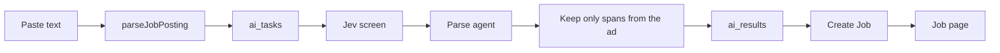

# Paste a job ad

Create a job from one pasted job advertisement. The job is saved immediately, the same way a LinkedIn scrape is. The user can fix fields on the existing job page.

Stop after each task below. Do not start the next task until it has been reviewed and approved.

## Design

- New task type `parse_job_posting`. Do not overload `scrape_job`.
- Input: `{ "text": "<pasted ad>" }`. Rails rejects a blank paste or one longer than `TextLimits::JOB_DESCRIPTION` (20_000) before enqueue.
- Completed result: `{ "scraped_job": ScrapedJobPosting }` so the existing warnings helper still works. `source` is `pasted_text`. `description` is the paste itself, not a rewrite. `requirements_sorted_by` is `llm`, or `none` when both lists are empty.
- The agent returns only `title`, `company`, optional `location`, optional `url`, and two lists of strings. An output validator (`retries=2`) sends the run back when title or company is blank or is not a case-insensitive substring of the ad, or when any bullet is not a substring. After retries are exhausted, the task fails with a message to paste the full ad or add the job manually. No job is saved with an invented title or company.
- Location or URL that is not in the ad is dropped, with a warning. No requirement bullets is allowed, with a warning. Bullets are capped to the existing Rails limits.
- Model name and thinking effort live in `services/ai/worker/settings.py` (default `openai:gpt-5-mini`, low thinking). The run uses the existing overall deadline. No second-provider fallback (the repo does not have one yet). The prompt module carries a version constant. Contact masking already wraps every agent.
- Jev screens the paste before it enters the prompt. A block, an unchecked screen, or text over the screen limit fails the task and does not call the parse agent.
- A blank URL must not use `find_by(url: nil)`. If the extracted URL is one this user already saved, return that job.

## Phase 1 — Queue and save

### Task 1 — Start the task

`Jobs::StartJobPostingParseService` validates the paste and enqueues `parse_job_posting`. GraphQL `parseJobPosting(text: String!)` returns `{ aiTask, errors }`, thin like `scrape_job`. Add the task type to `AiTask::TASK_TYPES`. Specs for the service and mutation.

### Task 2 — Save the job

`Jobs::CreateJobFromPastedPostingService` maps the posting onto a Job. `ApplyAiResultService` saves it inside the existing row lock when this task completes, and fails the task if the save fails. Specs for create and apply. Dump `schema.graphql`.

## Phase 2 — Extraction

### Task 3 — Agent and checks

Schema for the agent output only (title, company, location, url, requirements, nice_to_haves). Prompt in `prompts/` with a version constant. Agent in `agents/parse_job_posting_agent.py` (`defer_model_check=True`, model passed per run). The user message wraps the ad as data. A function turns a successful parse into a `ScrapedJobPosting` (paste as description, warnings, limit fitting). Unit tests for the substring checks, including an invented bullet and a title that is not in the ad.

### Task 4 — Handler

`handle_parse_job_posting_task`: screen, run, build the result, report usage for the screen and the parse. Register it in `task_handlers.py` and `TaskType` in `queue_messages.py`. Settings for model and thinking. Handler tests with the screen and agent mocked: happy path, blocked text, title not in the ad, invented bullet rejected.

### Task 5 — Evals

Deterministic eval set of a few synthetic ads (title, company, verbatim bullets, no invented bullets) and a runner next to the existing job-posting extraction evals. No LLM-as-judge.

## Phase 3 — Paste UI

### Task 6 — Paste form

Jobs list link **Paste a job ad** to `/jobs/paste`. `AddJobFromTextPage`: one textarea, `parseJobPosting`, then `/jobs/paste/:aiTaskId`. Page tests for submit and a validation error. Codegen after the schema dump if it was not already run.

### Task 7 — Task page

Follow `aiTaskUpdated` the same way `JobScrapeTaskPage` does: spinner, failure with a way back to the paste form, redirect to the job, warnings first when present. Share the status card with the scrape page if that stays smaller than copying it. Tests for failure and the completed redirect.

## Phase 4 — Finish

### Task 8 — Docs

Update `AGENTS.md` for `features/jobs`, `app/services`, and `services/ai` (worker, agents, schemas, job_postings). Add the `parse_job_posting` bullet in `docs/architecture.md`.

### Task 9 — Browser check

With Docker Compose up: paste a short synthetic ad and confirm the task page reaches a saved job with title, company, description, and requirement lines. Confirm an empty paste stays on the form with an error. Restart `api-results-worker` after the Rails apply-service change so it loads the new task type.
